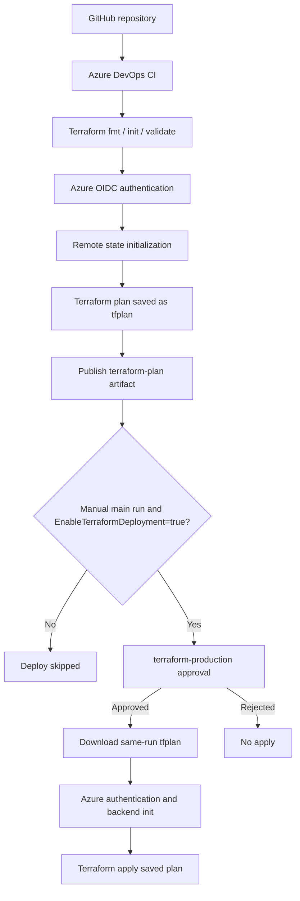

# Terraform Azure Infrastructure Provisioning with Azure DevOps CI/CD

> **Status: Completed and tested.** Terraform validation, remote-state planning, saved-plan artifact publishing, manual environment approval, and `terraform apply` all succeeded in Azure DevOps run **#20261019.24**. The approved plan showed **no changes**; provisioning a *new* resource through the pipeline remains an optional extension.

## Contents

- [Project overview](#project-overview)
- [Project evolution: original VM workflow to CI/CD](#project-evolution-original-vm-workflow-to-cicd)
- [Architecture](#architecture)
- [Technology stack](#technology-stack)
- [Infrastructure and configuration](#infrastructure-and-configuration)
- [Repository structure](#repository-structure)
- [Prerequisites](#prerequisites)
- [Terraform remote state](#terraform-remote-state)
- [Azure authentication](#azure-authentication)
- [Azure DevOps pipeline](#azure-devops-pipeline)
- [Manual deployment and approvals](#manual-deployment-and-approvals)
- [How to run](#how-to-run)
- [Evidence and results](#evidence-and-results)
- [Troubleshooting](#troubleshooting)
- [Security and cost management](#security-and-cost-management)
- [Future improvements](#future-improvements)
- [References](#references)

## Project overview

This project implements **Infrastructure as Code (IaC)** on Microsoft Azure using **Terraform**, with source control in **GitHub** and a two-stage **Azure DevOps YAML CI/CD pipeline**. Every qualifying push or pull request validates the Terraform configuration and creates a saved plan. Deployment is restricted to an explicitly enabled **manual run on `main`** and requires an approval check on the `terraform-production` environment.

**GitHub:** [johnson-busuyi/terraform-azure-provisioning](https://github.com/johnson-busuyi/terraform-azure-provisioning)  
**Azure DevOps organization:** `rebootforge`  
**Azure DevOps project:** `Customer-Churn-MLOps`  
**Pipeline:** `johnson-busuyi.terraform-azure-provisioning`

### Objectives

- Manage Azure infrastructure declaratively with Terraform.
- Track configuration changes in GitHub.
- Validate formatting and syntax before deployment.
- Use short-lived Azure workload identity federation rather than storing client secrets.
- Maintain Terraform state in Azure Blob Storage.
- Publish the exact Terraform plan as a pipeline artifact.
- Require an explicit manual run and human approval for `terraform apply`.
- Prevent ordinary commits and pull requests from applying infrastructure.
- Minimize costs in a learning environment.

## Project evolution: original VM workflow to CI/CD

The project began as a hands-on Terraform exercise on an **Azure Ubuntu Linux VM**. The original README documented the following foundation, which remains an important part of the project's history:

### Phase 1 — Terraform Azure provisioning on Ubuntu

**Original project overview:** Demonstrate Infrastructure as Code (IaC) using Terraform to provision Azure resources.

**Original technologies:** Terraform, Microsoft Azure, Azure Managed Identity, Git, GitHub, and Ubuntu Linux.

**Original infrastructure:**

- **Resource group:** `terraform-learning-rg`
- **Region:** East US (`eastus`)
- **Authentication:** System-assigned managed identity attached to the Azure Ubuntu VM
- **Execution environment:** Azure Ubuntu Linux VM (`johnson-busuyi-VM`)

**Original hands-on workflow:**

```bash
terraform init
terraform fmt
terraform validate
terraform plan
terraform apply
terraform state list
```

**Original security model:** The VM's Azure managed identity provided authentication without embedding Azure credentials in Terraform files. Local Terraform state files were excluded from Git. **Original result:** Successfully provisioned an Azure resource group using Terraform on the Azure Ubuntu VM.

### Phase 2 — Azure remote state

The project advanced from its initial local workflow to **Azure Blob Storage remote state**. State is stored in container `tfstate` in storage account `tfstoragejb20261017`, using key `terraform.tfstate`. Local state files remain excluded from Git; the authoritative state now resides in Azure Storage.

### Phase 3 — Azure DevOps continuous integration

GitHub changes trigger an Azure DevOps pipeline that installs Terraform, checks formatting, initializes for validation, validates the configuration, authenticates to Azure, creates a saved remote-state plan, and publishes the plan as a pipeline artifact.

### Phase 4 — Protected continuous delivery

The deployment stage is restricted to manually queued `main` branch runs with `EnableTerraformDeployment=true` and is protected by the `terraform-production` environment approval check. After approval, it downloads and applies the exact saved plan. The end-to-end workflow succeeded in pipeline run `#20261019.24` with **no infrastructure changes** required.

> **Authentication distinction:** The **original Ubuntu VM workflow** used its **system-assigned managed identity**. The **Azure DevOps pipeline** uses **workload identity federation (OIDC)** via the `terraform-azure-connection` service connection. These are separate authentication methods for separate execution environments; the pipeline does not rely on the VM being powered on.

## Architecture



The **CI stage** runs automatically. The **CD stage** runs only when manually enabled and approved.

## Technology stack

| Component | Implementation |
|---|---|
| Cloud | Microsoft Azure |
| Infrastructure as Code | Terraform `1.16.0` |
| Provider | HashiCorp AzureRM, `~> 4.0` |
| Source control | GitHub |
| CI/CD | Azure DevOps YAML Pipelines |
| Pipeline agent | Microsoft-hosted `ubuntu-24.04` (latest documented YAML) |
| Azure connection | `terraform-azure-connection` |
| Original VM authentication | System-assigned Azure Managed Identity |
| Pipeline authentication | Workload identity federation (OIDC) |
| Remote state | Azure Blob Storage |
| Plan artifact | `terraform-plan` / `tfplan` |
| Protected environment | `terraform-production` |

## Infrastructure and configuration

| Setting | Value |
|---|---|
| Resource group | `terraform-learning-rg` |
| Azure region | `eastus` |
| Storage account | `tfstoragejb20261017` |
| Storage SKU | Standard LRS |
| Backend container | `tfstate` |
| Backend key | `terraform.tfstate` |
| Tags | `Environment=Learning`, `ManagedBy=Terraform` |

The project manages an Azure resource group and storage account. The state backend was migrated to Azure Blob Storage and verified. The blob container and state file are critical infrastructure and must not be deleted as part of routine cleanup.

### Example AzureRM provider

```hcl
terraform {
  required_providers {
    azurerm = {
      source  = "hashicorp/azurerm"
      version = "~> 4.0"
    }
  }
}

provider "azurerm" {
  features {}
  subscription_id = "<your-azure-subscription-id>"
}
```

### Example infrastructure definitions

These blocks illustrate the resources, but **do not replace existing Terraform resource labels or addresses without checking state**.

```hcl
resource "azurerm_resource_group" "learning" {
  name     = "terraform-learning-rg"
  location = "eastus"
  tags = {
    Environment = "Learning"
    ManagedBy   = "Terraform"
  }
}

resource "azurerm_storage_account" "storage" {
  name                     = "tfstoragejb20261017"
  resource_group_name      = azurerm_resource_group.learning.name
  location                 = azurerm_resource_group.learning.location
  account_tier             = "Standard"
  account_replication_type = "LRS"
  tags = {
    Environment = "Learning"
    ManagedBy   = "Terraform"
  }
}
```

## Repository structure

A conventional layout is shown below. Some `.tf` files are optional and may be combined into `main.tf`; confirm actual names in the repository.

```text
terraform-azure-provisioning/
├── azure-pipelines.yml      # Azure DevOps CI/CD pipeline
├── main.tf                  # Terraform provider/resources
├── backend.tf               # Optional separate backend definition
├── variables.tf             # Optional inputs
├── outputs.tf               # Optional outputs
├── .terraform.lock.hcl      # Provider dependency lock
├── .gitignore               # Excludes local state/secrets/plans
└── README.md                # This documentation
```

## Prerequisites

1. Azure subscription and appropriate Azure RBAC permissions.
2. GitHub repository with Terraform configuration.
3. Azure DevOps organization and project.
4. Azure Resource Manager service connection using workload identity federation.
5. Existing Azure Storage backend (storage account and container) before backend initialization.
6. Azure DevOps environment with an approval check.
7. Terraform and Azure CLI for optional local development.

For local validation:

```bash
az login
az account show --output table
terraform version
terraform fmt -check -recursive
terraform init
terraform validate
terraform plan
```

## Terraform remote state

The backend stores shared Terraform state in Azure Blob Storage:

```hcl
terraform {
  backend "azurerm" {
    resource_group_name  = "terraform-learning-rg"
    storage_account_name = "tfstoragejb20261017"
    container_name       = "tfstate"
    key                  = "terraform.tfstate"
    use_azuread_auth     = true
  }
}
```

Pipeline initialization uses:

```bash
terraform init -reconfigure -input=false
```

Remote state provides a consistent view of managed resources between ephemeral pipeline agents. Protect state access: state may contain sensitive values. Do not commit `terraform.tfstate`, `.terraform/`, or `tfplan` binaries. Terraform's Azure backend also supports state locking, helping protect against concurrent state changes.

**Bootstrap consideration:** The backend must exist before a fresh Terraform initialization can use it. This project uses an already-established backend and completed state migration.

## Azure authentication

The Azure DevOps service connection `terraform-azure-connection` uses **workload identity federation**. The service principal has been granted Contributor on the Terraform resource group and Storage Blob Data Contributor for the state storage account.

The `AzureCLI@2` tasks set the Terraform authentication environment:

```yaml
- task: AzureCLI@2
  displayName: 'Terraform Plan - Remote State'
  inputs:
    azureSubscription: 'terraform-azure-connection'
    scriptType: 'bash'
    scriptLocation: 'inlineScript'
    addSpnToEnvironment: true
    inlineScript: |
      set -euo pipefail
      export ARM_USE_OIDC=true
      export ARM_USE_MSI=false
      export ARM_USE_AZUREAD=true
      export ARM_CLIENT_ID="$servicePrincipalId"
      export ARM_TENANT_ID="$tenantId"
      export ARM_OIDC_TOKEN="$idToken"
      export ARM_SUBSCRIPTION_ID="$(az account show --query id -o tsv)"
      terraform init -reconfigure -input=false
      terraform plan -input=false -no-color -out=tfplan
```

This avoids embedding a static service principal password in YAML. Keep service connection access and Azure RBAC scoped to what the pipeline needs.

## Azure DevOps pipeline

The source of truth for executable pipeline configuration is **`azure-pipelines.yml` in GitHub**.

### Stage 1: `Terraform_Plan`

1. Checkout Terraform repository.
2. Install Terraform `1.16.0`.
3. Run `terraform fmt -check -recursive`.
4. Run `terraform init -backend=false -input=false`.
5. Run `terraform validate -no-color`.
6. Authenticate to Azure using `AzureCLI@2` and OIDC.
7. Initialize the remote backend.
8. Run `terraform plan -input=false -no-color -out=tfplan`.
9. Display the saved plan.
10. Publish the `terraform-plan` artifact containing `tfplan`.

### Stage 2: `Terraform_Deploy`

The deployment stage uses the following **corrected condition**:

```yaml
condition: and(succeeded(), eq(variables['Build.SourceBranch'], 'refs/heads/main'), eq(variables['Build.Reason'], 'Manual'), eq(variables['EnableTerraformDeployment'], 'true'))
```

All four conditions must be satisfied. The deployment job references:

```yaml
environment: 'terraform-production'
```

The **approval check is configured in the Azure DevOps environment UI**, not automatically created by the YAML reference.

After approval, the deployment job installs Terraform, downloads the artifact from the **current run**, verifies its presence, authenticates to Azure, initializes the backend, and applies the saved plan:

```yaml
- download: current
  artifact: terraform-plan
  displayName: 'Download Terraform Plan Artifact'
```

```bash
PLAN_FILE="$(Pipeline.Workspace)/terraform-plan/tfplan"
test -f "$PLAN_FILE" || { echo 'Plan file missing'; exit 1; }
terraform init -reconfigure -input=false
terraform show -no-color "$PLAN_FILE"
terraform apply -input=false -no-color "$PLAN_FILE"
```

The `terraform apply` command runs inside an authenticated `AzureCLI@2` task. A successful plan stage **does not** mean deployment has occurred.

## Manual deployment and approvals

The deployment switch is defined in **Azure DevOps pipeline UI variables**, not duplicated in YAML:

| Setting | Value |
|---|---|
| Name | `EnableTerraformDeployment` |
| Default | `false` |
| Secret | No |
| Allow override at queue time | Yes |

| Pipeline run | Variable | Expected deployment behavior |
|---|---|---|
| GitHub push to `main` | Any | Skipped; not manually queued |
| Pull request | Any | Skipped |
| Manual run on `main` | `false` | Skipped |
| Manual run on `main` | `true` | Requires `terraform-production` approval, then applies saved plan |

**Safety:** Manual execution and a `true` variable do not replace review. Inspect the plan **from that same run** before approving. A non-empty plan can provision billable resources.

## How to run

### Automatic CI

Push a commit to `main` or open an eligible pull request. Check that formatting, initialization, validation, plan, and artifact publication succeed. Deployment should be skipped for an automatically triggered run.

### Manual plan-only test

1. Go to **Azure DevOps → Pipelines**.
2. Select `johnson-busuyi.terraform-azure-provisioning`.
3. Choose **Run pipeline**, branch `main`.
4. Leave `EnableTerraformDeployment=false`.
5. Run and inspect the Terraform plan and published artifact.

### Approval-controlled Terraform Apply

1. Select **Run pipeline**, branch `main`.
2. In **Variables**, set `EnableTerraformDeployment=true` **for this run**.
3. Start the pipeline and review its newly generated plan.
4. Confirm any additions, changes, or deletions are intended and affordable.
5. Review the pending approval for `terraform-production` and verify the run ID.
6. Approve the run.
7. Verify that **Terraform Apply - Approved Plan** succeeds.
8. Leave the saved pipeline variable default at `false`.

## Evidence and results

### Verified implementation milestones

- Terraform resource group and storage account managed with remote Azure Blob state.
- Terraform remote-state initialization and state migration succeeded.
- Azure service connection authenticated successfully using OIDC.
- CI formatting, validation, plan, and artifact publishing passed.
- Deployment job successfully downloaded and verified the saved plan.
- Manual environment approval was successfully exercised.
- **Pipeline run `#20261019.24`** showed green success indicators for both stages, including **Terraform Apply - Approved Plan**.

The plan reviewed during testing stated:

```text
No changes. Your infrastructure matches the configuration.
```

**Interpretation:** The end-to-end deployment workflow is verified, including an actual invocation of `terraform apply`. Because the plan had no changes, this run **did not demonstrate creating a new Azure resource**. That optional demonstration can be added later.

### Suggested portfolio screenshots

Capture and add screenshots under `docs/screenshots/` if desired:

- Successful Plan stage and published artifact.
- `terraform-production` approval request.
- Successful deployment stage with `Terraform Apply - Approved Plan` green.
- Terraform plan summary showing no changes.
- Azure resource group and storage account.

Avoid publishing sensitive tenant identifiers, tokens, or confidential account information.

## Troubleshooting

### Deployment skipped even though the variable was `true`

**Root cause encountered:** The YAML used:

```yaml
ne(variables['Build.Reason'], 'Manual')
```

`ne` means **not equal**, so manual runs were excluded. The correct condition is:

```yaml
eq(variables['Build.Reason'], 'Manual')
```

### Approval button does not appear

First inspect the stage status. **Skipped due to conditions** means no approval was requested. **Waiting for approval** means the stage has reached an approval check. Check the pipeline run summary and the environment's **Approvals and checks** settings; do not assume the Jobs log view contains the approval button.

### Runtime Variables tab appears empty

An automatically triggered GitHub run may not display queue-time overrides. Inspect the **Run pipeline → Variables** dialog for a new manual run. An empty historical run's Variables tab alone does not prove the saved pipeline UI variable was deleted.

### YAML indentation errors

Tasks under `steps:` must align with one another. Shell commands must stay inside the `bash: |` or `inlineScript: |` block. An earlier version had a misaligned `- bash:` and commands outside the block.

### Terraform Apply in the wrong task

Keep `terraform apply` inside the authenticated `AzureCLI@2` task after backend initialization, not inside the plain Bash file-verification task.

### Artifact published but missing during deployment

Publish from the Plan job, then explicitly download in the deployment job using `download: current`. The expected path is:

```text
$(Pipeline.Workspace)/terraform-plan/tfplan
```

### Agent image changes

The `ubuntu-latest` label can change. The latest documented pipeline pins `ubuntu-24.04` for more predictable behavior. Review supported images periodically.

## Security and cost management

### Security

- Use workload identity federation instead of long-lived secrets.
- Keep the GitHub repository and pipeline permissions appropriately restricted.
- Protect `main` with branch policies and code review.
- Restrict Azure RBAC to the smallest necessary scope.
- Keep `terraform-production` approval checks enabled and limit approvers.
- Treat **saved Terraform plan binaries as potentially sensitive**; restrict artifact access and retention.
- Do not commit state files, `.terraform/`, credentials, or saved plan binaries.
- Review the plan before approval; regenerate a new plan if state has changed.
- Consider serialized deployments and stronger checks for production usage.

### Azure cost management

- Terraform's **no-change** apply does not create new resources, but existing resources can continue accruing charges.
- The separate Ubuntu learning VM `johnson-busuyi-VM` is not required for Microsoft-hosted CI/CD agents and can remain deallocated when unused.
- Storage accounts, VM disks, and some networking components may still have ongoing charges.
- Previously unused AKS and container registry resources were removed to reduce spending.
- Azure budgets provide alerts, **not automatic spending caps**.
- Inspect pricing before adding resources, especially VMs, managed Kubernetes, databases, or premium storage.

## Future improvements

The current project is **complete**. Optional enhancements include:

1. Add a small, low-cost resource through Terraform, review a non-empty plan, approve it, and confirm Azure creation.
2. Add plan summaries to pull-request reviews.
3. Integrate `tflint` and IaC security checks.
4. Add Terraform module structure and reusable environments.
5. Add explicit artifact retention and deployment concurrency controls.
6. Add cost estimation and policy-as-code checks.
7. Add sanitized screenshots and architecture evidence to the README.

## Useful commands

```bash
# Terraform
terraform version
terraform fmt -check -recursive
terraform init -reconfigure
terraform validate
terraform plan -out=tfplan
terraform show -no-color tfplan
terraform state list

# Azure CLI
az login
az account show --output table
az group show --name terraform-learning-rg --output table
az storage account show \
  --name tfstoragejb20261017 \
  --resource-group terraform-learning-rg \
  --output table

# Git
git status
git add README.md
git commit -m "Add comprehensive Terraform Azure DevOps README"
git push origin main
```

Do not run a local `terraform apply` without reviewing the plan and confirming the intended target state; the approved pipeline is the preferred deployment workflow for this project.

## References

- [Terraform documentation](https://developer.hashicorp.com/terraform/docs)
- [Terraform AzureRM backend](https://developer.hashicorp.com/terraform/language/backend/azurerm)
- [AzureRM provider documentation](https://registry.terraform.io/providers/hashicorp/azurerm/latest/docs)
- [Azure Pipelines YAML schema](https://learn.microsoft.com/azure/devops/pipelines/yaml-schema/)
- [Azure DevOps approvals and checks](https://learn.microsoft.com/azure/devops/pipelines/process/approvals)
- [Azure service connections](https://learn.microsoft.com/azure/devops/pipelines/library/connect-to-azure)
- [Azure Cost Management](https://learn.microsoft.com/azure/cost-management-billing/)

---

**Outcome:** A functioning Terraform-on-Azure CI/CD implementation with GitHub version control, remote state, OIDC authentication, automatic validation/planning, saved-plan artifacts, and a successfully tested manual-approval-controlled Apply stage.
